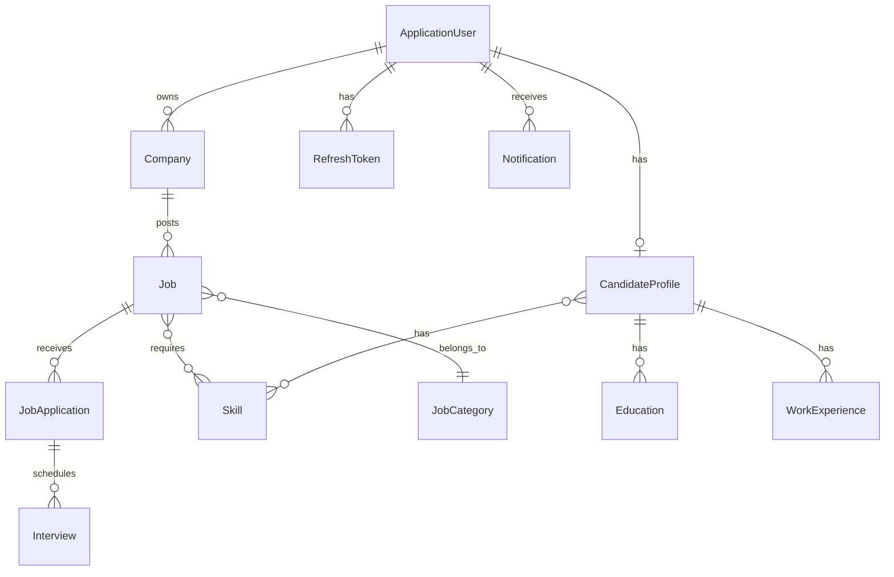

# JobFlow — Professional Job Management System

A production-ready **Job Portal REST API** built with **ASP.NET Core 9**, **Entity Framework Core**, and **Microsoft SQL Server**.

**Author:** [Maksudul Hoque Khan](https://github.com/maksudulkhan328)

---

## Features

| Role | Capabilities |
|------|-------------|
| **Admin** | Dashboard stats, user management, job moderation (approve/reject/publish), categories & skills |
| **Employer** | Company profiles, post & manage jobs, review applicants, update application statuses, recruiter notes |
| **Job Seeker** | Profile with CV upload, education & experience, browse & apply for jobs, track applications, notifications |

### Key Technical Features
- JWT access tokens + secure refresh token rotation
- Role-based authorization (Admin / Employer / JobSeeker)
- Full job lifecycle: `Draft → Pending Approval → Published → Closed`
- Application workflow: `Submitted → Under Review → Shortlisted → Interview Scheduled → Offered → Hired`
- Server-side validation of all status transitions
- Soft deletes, audit fields, IDOR protection
- Global exception middleware with consistent API responses
- Structured logging with Serilog
- Rate limiting on auth endpoints
- File upload for CVs (PDF) and company logos

---

## Tech Stack

- **.NET 9** / ASP.NET Core Web API
- **Entity Framework Core 9** (Code-First)
- **Microsoft SQL Server** (LocalDB for development)
- **ASP.NET Core Identity** with JWT
- **FluentValidation**
- **Serilog**
- **Swagger / OpenAPI**

---

## Architecture

```
backend/
├── JobFlow.sln
├── JobFlow.Domain/          # Entities, Enums, BaseEntity
├── JobFlow.Application/     # DTOs, Service Interfaces, Common
├── JobFlow.Infrastructure/  # EF Core DbContext, Service Implementations, DI
└── JobFlow.Api/             # Controllers, Middleware, Extensions, Program.cs
```

---

## Database Setup

### Prerequisites
- SQL Server or LocalDB (included with Visual Studio)
- .NET 9 SDK

### Run Migrations

```bash
cd backend
dotnet ef database update --project JobFlow.Infrastructure --startup-project JobFlow.Api
```

The app also auto-migrates and seeds on startup (development mode).

### Demo Accounts (seeded automatically)

| Role | Email | Password |
|------|-------|----------|
| Admin | `admin@jobflow.dev` | `Admin@123456` |
| Employer | `employer@demo.com` | `Demo@123456` |
| Job Seeker | `seeker@demo.com` | `Demo@123456` |

---

## Running the API

```bash
cd backend/JobFlow.Api
dotnet run
```

API: `http://localhost:5000`  
Swagger UI: `http://localhost:5000/swagger`

---

## Environment Variables

Copy `backend/.env.example` and configure:

```json
// appsettings.Development.json
{
  "ConnectionStrings": {
    "DefaultConnection": "Server=(localdb)\\MSSQLLocalDB;Database=JobFlowDb_Dev;..."
  },
  "Jwt": {
    "Key": "your-secret-key-min-32-chars",
    "Issuer": "JobFlowApi",
    "Audience": "JobFlowClient",
    "ExpiresInMinutes": 60,
    "RefreshTokenExpiryDays": 7
  }
}
```

**Never commit real secrets.** Use `dotnet user-secrets` for local development.

---

## API Endpoints

### Authentication
| Method | Endpoint | Description |
|--------|----------|-------------|
| POST | `/api/auth/register` | Register (Employer or JobSeeker) |
| POST | `/api/auth/login` | Login → returns JWT + refresh token |
| POST | `/api/auth/refresh` | Rotate refresh token |
| POST | `/api/auth/logout` | Revoke refresh token |
| GET | `/api/auth/me` | Get current user |

### Jobs
| Method | Endpoint | Auth |
|--------|----------|------|
| GET | `/api/jobs` | Public |
| GET | `/api/jobs/{id}` | Public |
| POST | `/api/jobs` | Employer |
| PUT | `/api/jobs/{id}` | Employer (owner) |
| DELETE | `/api/jobs/{id}` | Employer (owner) |
| POST | `/api/jobs/{id}/submit` | Employer |
| POST | `/api/jobs/{id}/publish` | Admin |
| POST | `/api/jobs/{id}/reject` | Admin |
| POST | `/api/jobs/{id}/close` | Employer |
| GET | `/api/jobs/my` | Employer |
| GET | `/api/jobs/admin/all` | Admin |

### Applications
| Method | Endpoint | Auth |
|--------|----------|------|
| POST | `/api/applications/jobs/{jobId}/apply` | JobSeeker |
| GET | `/api/applications/my` | JobSeeker |
| GET | `/api/applications/jobs/{jobId}/applications` | Employer |
| PATCH | `/api/applications/{id}/status` | Employer |
| POST | `/api/applications/{id}/withdraw` | JobSeeker |

### Companies, Profile, Categories, Skills, Notifications, Admin — see Swagger UI

---

## Database Schema (ER Overview)



---

## CI/CD

GitHub Actions workflow: `.github/workflows/backend.yml`  
Runs on every push/PR to `main`: build + test.

---

## Security Notes

- Passwords hashed by ASP.NET Core Identity (PBKDF2)
- JWT short-lived (60 min default), refresh tokens rotate on use
- IDOR protection: resource-level ownership checks on every endpoint
- Rate limiting on `/api/auth/*` (10 req/min)
- File uploads validated by extension and size
- CORS restricted to configured origins
- No secrets in source code

---

## Future Improvements

- [ ] React frontend
- [ ] SignalR for real-time notifications
- [ ] Email notifications (SendGrid)
- [ ] Elasticsearch for full-text job search
- [ ] Redis caching
- [ ] Docker / docker-compose
- [ ] Deployment to Azure App Service

---

*Built with ❤️ by [Maksudul Hoque Khan](https://github.com/maksudulkhan328)*
